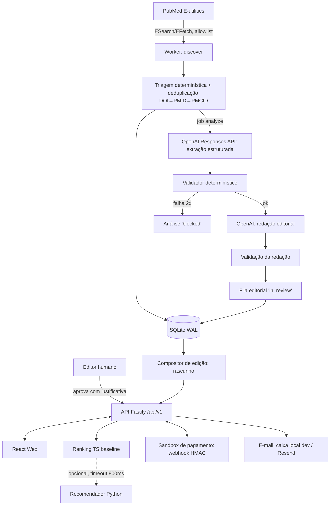

# Arquitetura (estado real em 2026-11-14)

Monólito modular em Node.js/TypeScript. Dois processos do mesmo pacote (`apps/server`): **API** (`src/api/main.ts`) e **worker** (`src/worker/main.ts`). SPA React separada (`apps/web`), servida pela própria API quando compilada. Recomendador Python opcional.

## Módulos (`apps/server/src`)
| Pasta/arquivo | Responsabilidade |
|---|---|
| `config.ts` | Validação do ambiente com zod; produção exige segredos e e-mail real |
| `db/` | `node:sqlite`, migrações SQL versionadas, seed (taxonomia, fontes, planos, flags, demo) |
| `modules/auth.ts` | OTP de 6 dígitos (HMAC com segredo do servidor), sessões com token aleatório (só hash no banco) |
| `modules/content.ts` | DTOs de leitura; regra de visibilidade (demo × real por flag) |
| `modules/editorial.ts` | Fila, decisão auditada, versões imutáveis, composição e publicação |
| `modules/ranking.ts` | Ranking explicável + diversidade + fallback do Python |
| `modules/billing.ts` | Planos, checkout sandbox, webhook HMAC idempotente, entitlement com carência |
| `modules/jobs.ts` | Fila durável: idempotência, lease, backoff com jitter, Retry-After, bloqueio |
| `sources/pubmed.ts` | Adaptador `ScientificSourceAdapter` real (E-utilities) |
| `ai/` | Provedor HTTP OpenAI (Structured Outputs estrito), prompts versionados, validador, orçamento |
| `worker/` | Ingestão, runner de jobs, agendador, CLI do pipeline |
| `api/` | Rotas públicas, do leitor, billing, admin; OpenAPI gerado |

## Segurança implementada
Cookie de sessão HttpOnly + SameSite=Lax (+ Secure em produção); rotação ao autenticar; logout e logout-all; CSRF por cabeçalho `X-Requested-With` obrigatório em mutações; RBAC no servidor em toda rota admin; rate limit global e de auth, cooldown de reenvio, 5 tentativas por código; resposta idêntica com e sem conta; Helmet/CSP restritiva; erros `{code,message,requestId}` sem stack; consultas parametrizadas; saída de rede só para hosts da allowlist, sem redirecionamento; conteúdo externo delimitado e tratado como dado nos prompts; segredos só no servidor (teste verifica o bundle); mensagens de erro de jobs sanitizadas.

**Ainda não feito:** autenticação reforçada para a equipe (2º fator), limites por IP atrás de proxy configurados para produção, rotação de segredos documentada, CSP com nonce (hoje `style-src 'unsafe-inline'` por causa de estilos inline do React), Dependabot/CI.

## Modelo de dados
Ver `apps/server/src/db/migrations/001_init.sql` (30 tabelas). Pontos-chave: DOI/PMID/PMCID únicos e opcionais (ID interno é UUID); `article_sources` versionado por hash de conteúdo, com licença; `analyses` versionadas (`in_review → published → superseded`), resultados e claims em tabelas próprias; `editions` por data+versão+demo; `jobs.idempotency_key` único; `billing_events (provider, external_event_id)` único; `read_events` único por usuário/artigo/tipo/dia.

## SQLite → PostgreSQL
1. O SQL usa um subconjunto portável (TEXT ISO-8601, `ON CONFLICT`, `RETURNING`, CTE recursiva, tuplas em comparação). Pontos específicos a trocar: `json_extract`/`json_each` → `jsonb` (`->>`, `jsonb_array_elements_text`), `INSERT OR IGNORE` → `ON CONFLICT DO NOTHING`, `PRAGMA` removidos, `BEGIN IMMEDIATE` → `BEGIN`.
2. Introduzir um driver `pg` atrás da classe `Db` (mesma interface `get/all/run/tx`, `?` → `$n`).
3. Migrar dados: `npm run db:backup`, exportar tabela a tabela (CSV/JSON), importar no Postgres, conferir contagens e hashes por tabela, janela de manutenção com escrita congelada. Trocar o driver **não** migra dados sozinho.
4. Quando: mais de uma instância de escrita, ou contenção medida no SQLite.

## Hospedagem (planejada, não executada)
Exige volume persistente (SQLite não pode ficar em disco efêmero/serverless). Um processo API + um worker no mesmo host com o volume; backups `VACUUM INTO` agendados e cópia cifrada fora do host; restore testado com `restore-check`. Nenhum deploy foi feito.
